# AI-Based Technology for Diabetic Retinopathy

Course: Mathematics Behind AI. Supervisor: Dr. Rohit Ahuja.

**Status (2026-11-27):** code and experiments are complete. The research paper (including the maths write-up) is
being written by another project member.

**This file is the handover document for the research paper.** It covers the data, method, experimental setup
(ablation study, statistical analysis, cross-dataset validation), results, figures, limitations and a
section-by-section explanation of the code. The figures are read from `results/figures/`, so keep that folder
next to this file.

## Contents
1. [Overview](#1-overview)
2. [Datasets](#2-datasets)
3. [Preprocessing and augmentation](#3-preprocessing-and-augmentation)
4. [Models and training](#4-models-and-training)
5. [Evaluation metrics](#5-evaluation-metrics)
6. [Main results](#6-main-results)
7. [Experimental setup A: ablation study](#7-experimental-setup-a-ablation-study)
8. [Experimental setup B: statistical analysis](#8-experimental-setup-b-statistical-analysis)
9. [Experimental setup C: cross-dataset validation](#9-experimental-setup-c-cross-dataset-validation)
10. [Separate experiment: fine-tuning on IDRiD](#10-separate-experiment-fine-tuning-on-idrid)
11. [Explainability: Grad-CAM](#11-explainability-grad-cam)
12. [Limitations](#12-limitations)
13. [Code explanation, file by file](#13-code-explanation-file-by-file)
14. [How to run this project on a new PC](#14-how-to-run-this-project-on-a-new-pc)
15. [Notes for the paper author](#15-notes-for-the-paper-author)

## 1. Overview
**Task:** grade diabetic retinopathy (DR) from a colour fundus photograph into five ordered classes:
0 none, 1 mild, 2 moderate, 3 severe, 4 proliferative. A second, binary view is **referable DR** (grade 2 or higher).

**Main model:** the original APTOS-trained EfficientNet-B0 (`full`). Its results are the main results of this
project. Fine-tuning on IDRiD (section 10) is a **separate experiment** and does not replace it.

**Main setup:** EfficientNet-B0 pretrained on ImageNet, fine-tuned on APTOS 2019, and tested on an APTOS test
split and on a second dataset, IDRiD.

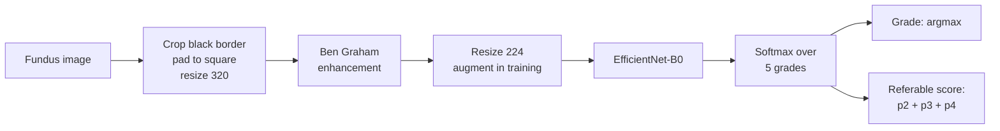

**Headline findings**
- APTOS test: quadratic weighted kappa (QWK) 0.869 ± 0.021 (mean ± SD, 3 seeds).
- On IDRiD, which this model never trained on, QWK falls to 0.663 ± 0.017. Referable-DR AUC is 0.908.
- No ablation made a statistically significant difference on the APTOS test set (McNemar and DeLong, Holm-corrected).
- Fine-tuning on IDRiD raised 5-grade accuracy there, but the QWK gain was not significant and APTOS performance fell.

## 2. Datasets
| Dataset | Role | Labelled images used | Source |
|---|---|---|---|
| APTOS 2019 Blindness Detection | training, validation, test | 3,504 | Kaggle competition data |
| IDRiD, Disease Grading | external test; reverse direction; fine-tuning | 516 | CC BY 4.0 mirror: https://zenodo.org/records/17219542 |

IDRiD citation: Porwal et al., "Indian Diabetic Retinopathy Image Dataset (IDRiD): A Database for Diabetic
Retinopathy Screening Research", *Data*, 3(3), 25, 2018.

**Cleaning (APTOS):** the 3,662 labelled files contain byte-identical copies (123 groups, 251 files).
The 30 groups whose copies carry different grades were removed completely; one image was kept from each other
group, leaving 3,504. Without this, a copy of a training image could appear in the test set. The 1,928 images
in APTOS `test_images/` have no labels and were not used.

**Splits:** APTOS 70/15/15, stratified by grade, seed 42. IDRiD keeps its official 103-image test set;
15% of its 413 training images are held out (stratified, seed 42) for validation.

| Split | Grade 0 | Grade 1 | Grade 2 | Grade 3 | Grade 4 | Total |
|---|---|---|---|---|---|---|
| APTOS test | 270 | 51 | 138 | 27 | 40 | 526 |
| APTOS train | 1257 | 236 | 645 | 124 | 190 | 2452 |
| APTOS val | 269 | 51 | 139 | 26 | 41 | 526 |
| IDRID test | 34 | 5 | 32 | 19 | 13 | 103 |
| IDRID train | 114 | 17 | 115 | 63 | 42 | 351 |
| IDRID val | 20 | 3 | 21 | 11 | 7 | 62 |
| Total | 1964 | 363 | 1090 | 270 | 333 | 4020 |

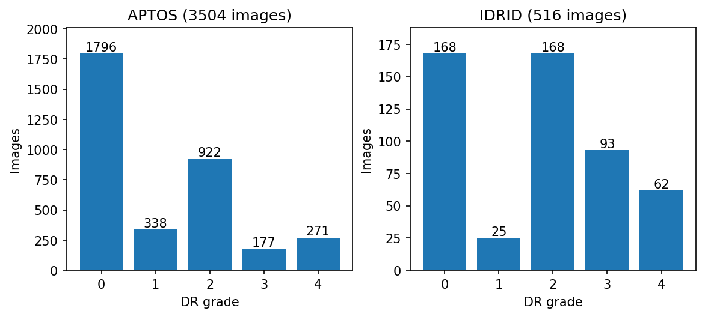

*Figure 1. Images per grade in each dataset (after cleaning). Both are imbalanced.*

## 3. Preprocessing and augmentation
1. **Crop** to the bounding box of pixels with grey level above 7, which removes the black border.
2. **Pad** to a square, so the retina is not stretched, and **resize** to 320×320 (area interpolation).
3. **Ben Graham enhancement**, applied to all three colour channels:

   $$I' = 4I - 4\,(G_\sigma * I) + 128,\qquad \sigma = 320/30$$

   $G_\sigma * I$ is the Gaussian-blurred image (the local average colour and illumination). Subtracting it
   acts as a high-pass filter: slow changes in lighting are suppressed, while vessels and lesions are amplified.
   Values are clipped to 0–255 and a circular mask of radius 0.95 × half-width removes the rim.
4. Resize to the model input (224, or 320 in one ablation).
5. **Augmentation (training only):** rotation by a uniform angle in 0–360°, random mirror, scale about 0.9–1.1,
   brightness and contrast factors 0.85–1.15.
6. **Normalisation** with the ImageNet channel means and standard deviations.

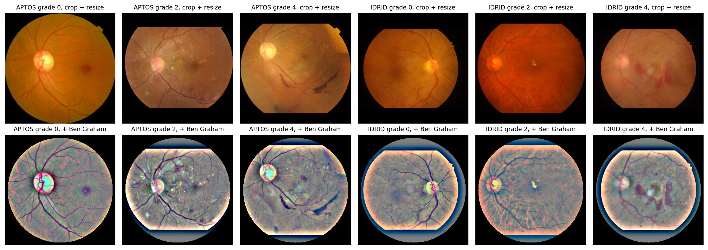

*Figure 2. Cropped and resized images (top) and the same images after Ben Graham enhancement (bottom).
Where an image was padded, the enhancement leaves grey and dark bands at the edge.*

## 4. Models and training
| Model | Trainable parameters | Description |
|---|---|---|
| EfficientNet-B0 | 4.01 M | main setup, ImageNet-pretrained, all layers fine-tuned |
| ResNet50 | 23.52 M | larger ImageNet-pretrained backbone |
| CNN from scratch | 0.98 M | 5 × (3×3 convolution, batch norm, ReLU, 2×2 max pool) with 32, 64, 128, 256, 256 filters, then global average pooling, dropout 0.3, linear layer |
| RBF SVM | – | on hand-crafted features |
| Logistic regression | – | on hand-crafted features |

**Loss:** class-weighted cross-entropy over softmax probabilities $p_k = e^{z_k}/\sum_j e^{z_j}$:

$$L = -\frac{\sum_i w_{y_i}\log p_{i,y_i}}{\sum_i w_{y_i}},\qquad w_c = \frac{N}{K\,n_c}$$

with $N$ training images, $K=5$ classes and $n_c$ images of class $c$. Rare grades get larger weights.

**Optimiser:** AdamW (weight decay 0.01) with a one-cycle learning-rate schedule (20% warm-up), mixed
precision, batch size 32 (the last incomplete batch of an epoch is skipped).

| Setting | EfficientNet-B0 | ResNet50 | CNN from scratch |
|---|---|---|---|
| Peak learning rate | 5e-4 | 2e-4 | 2e-3 |
| Epochs | 12 | 12 | 25 |

**Model selection:** the epoch with the highest validation QWK on the training dataset is kept.
Test images are never used for this. Each neural network is trained with seeds 0, 1 and 2.

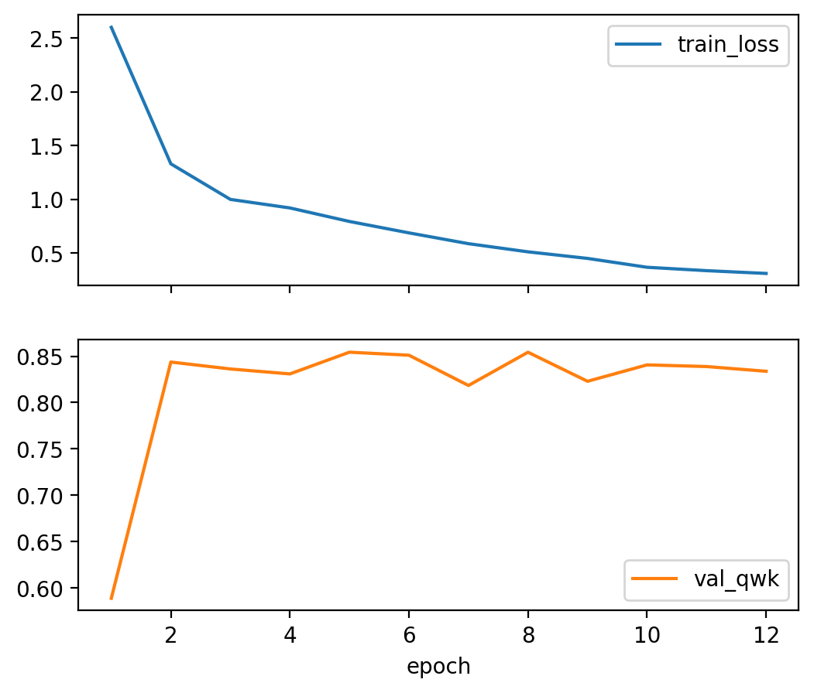

*Figure 3. Training loss and validation QWK per epoch (EfficientNet-B0, seed 0).*

## 5. Evaluation metrics
- **Quadratic weighted kappa (primary):** agreement beyond chance, with larger penalties for larger grade errors.

  $$\kappa = 1 - \frac{\sum_{ij} w_{ij}O_{ij}}{\sum_{ij} w_{ij}E_{ij}},\qquad w_{ij} = \frac{(i-j)^2}{(K-1)^2}$$

  $O$ is the confusion matrix and $E$ the matrix expected from its row and column totals.
- **Accuracy** and **macro F1** (unweighted mean of the five per-class F1 scores).
- **Macro AUC:** one-vs-rest ROC AUC averaged over the classes.
- **Referable DR:** score $p_2+p_3+p_4$, positive class = grade ≥ 2. AUC, and **sensitivity** and
  **specificity** at a threshold of 0.5.

## 6. Main results
Mean ± SD over 3 seeds. SVM and logistic regression are single fits. All are trained on APTOS.

### APTOS test set (526 images)
| Model | QWK | Accuracy | Macro F1 | Macro AUC | Referable AUC | Sensitivity | Specificity |
|---|---|---|---|---|---|---|---|
| full | 0.869 ± 0.021 | 0.768 ± 0.033 | 0.601 ± 0.041 | 0.934 ± 0.007 | 0.981 ± 0.002 | 0.847 ± 0.016 | 0.966 ± 0.008 |
| resnet50 | 0.874 ± 0.004 | 0.778 ± 0.019 | 0.630 ± 0.031 | 0.939 ± 0.004 | 0.982 ± 0.001 | 0.883 ± 0.042 | 0.949 ± 0.013 |
| scratch_cnn | 0.845 ± 0.014 | 0.750 ± 0.005 | 0.595 ± 0.007 | 0.928 ± 0.003 | 0.973 ± 0.002 | 0.805 ± 0.043 | 0.956 ± 0.019 |
| svm_rbf | 0.807 | 0.783 | 0.530 | 0.913 | 0.966 | 0.941 | 0.869 |
| logreg | 0.763 | 0.700 | 0.536 | 0.905 | 0.958 | 0.883 | 0.900 |

### IDRiD, all 516 images (external)
| Model | QWK | Accuracy | Macro F1 | Macro AUC | Referable AUC | Sensitivity | Specificity |
|---|---|---|---|---|---|---|---|
| full | 0.663 ± 0.017 | 0.432 ± 0.018 | 0.398 ± 0.025 | 0.804 ± 0.009 | 0.908 ± 0.001 | 0.765 ± 0.020 | 0.898 ± 0.008 |
| resnet50 | 0.726 ± 0.021 | 0.457 ± 0.017 | 0.420 ± 0.007 | 0.818 ± 0.001 | 0.934 ± 0.002 | 0.759 ± 0.025 | 0.957 ± 0.012 |
| scratch_cnn | 0.595 ± 0.006 | 0.375 ± 0.011 | 0.324 ± 0.002 | 0.777 ± 0.004 | 0.928 ± 0.008 | 0.525 ± 0.042 | 0.986 ± 0.003 |
| svm_rbf | 0.531 | 0.459 | 0.351 | 0.738 | 0.864 | 0.913 | 0.554 |
| logreg | 0.639 | 0.318 | 0.296 | 0.757 | 0.885 | 0.759 | 0.824 |

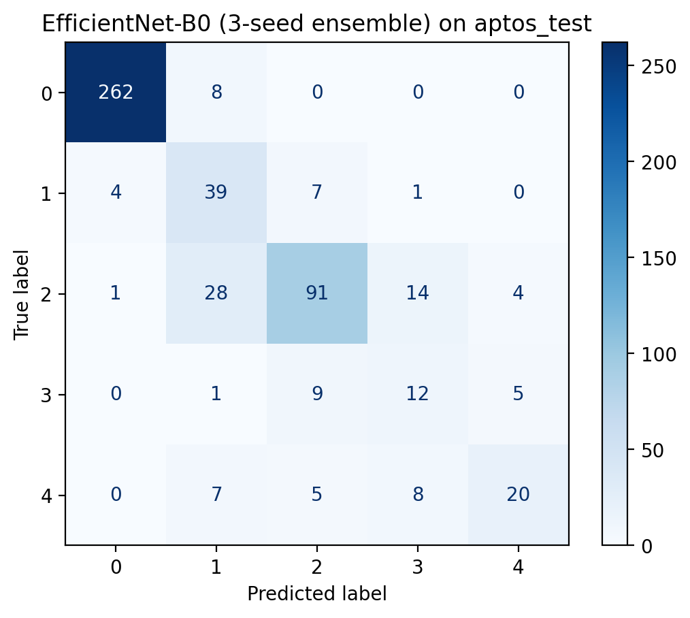

*Figure 4. Confusion matrix, EfficientNet-B0 with probabilities averaged over 3 seeds, APTOS test.*

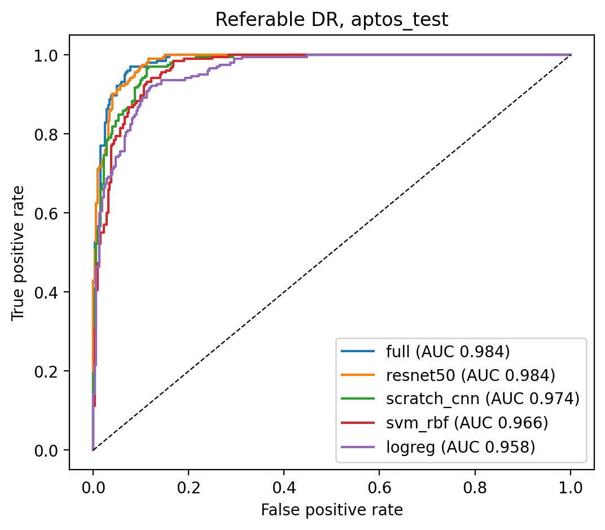

*Figure 5. Referable-DR ROC curves, APTOS test (seed-averaged probabilities).*

## 7. Experimental setup A: ablation study
**Design:** start from the main setup and change **one** component per experiment. Same split, same
seeds (0, 1, 2), same selection rule.

| Experiment | Component tested | Change |
|---|---|---|
| `full` | reference | EfficientNet-B0, Ben Graham, augmentation, class weights, 224 px |
| `no_preproc` | preprocessing | Ben Graham removed (crop and resize stay) |
| `no_aug` | augmentation | no augmentation |
| `no_class_weight` | imbalance handling / loss | unweighted cross-entropy |
| `size320` | input size | 320 px |
| `resnet50` | backbone | ResNet50 (learning rate also changed to 2e-4) |
| `scratch_cnn` | pretraining and architecture | CNN from scratch (learning rate and epochs also differ) |

The last two compare whole models rather than isolating one component.

| Experiment | Validation QWK | APTOS QWK | APTOS accuracy | APTOS referable AUC | IDRiD QWK | IDRiD accuracy | IDRiD referable AUC |
|---|---|---|---|---|---|---|---|
| full | 0.867 | 0.869 ± 0.021 | 0.768 ± 0.033 | 0.981 ± 0.002 | 0.663 ± 0.017 | 0.432 ± 0.018 | 0.908 ± 0.001 |
| no_preproc | 0.883 | 0.857 ± 0.012 | 0.773 ± 0.013 | 0.975 ± 0.002 | 0.683 ± 0.016 | 0.448 ± 0.017 | 0.913 ± 0.018 |
| no_aug | 0.869 | 0.861 ± 0.022 | 0.792 ± 0.018 | 0.974 ± 0.006 | 0.617 ± 0.026 | 0.452 ± 0.021 | 0.906 ± 0.026 |
| no_class_weight | 0.875 | 0.881 ± 0.009 | 0.813 ± 0.014 | 0.980 ± 0.002 | 0.650 ± 0.034 | 0.469 ± 0.039 | 0.925 ± 0.005 |
| size320 | 0.848 | 0.846 ± 0.053 | 0.766 ± 0.053 | 0.968 ± 0.009 | 0.708 ± 0.023 | 0.475 ± 0.026 | 0.936 ± 0.005 |
| resnet50 | 0.880 | 0.874 ± 0.004 | 0.778 ± 0.019 | 0.982 ± 0.001 | 0.726 ± 0.021 | 0.457 ± 0.017 | 0.934 ± 0.002 |
| scratch_cnn | 0.856 | 0.845 ± 0.014 | 0.750 ± 0.005 | 0.973 ± 0.002 | 0.595 ± 0.006 | 0.375 ± 0.011 | 0.928 ± 0.008 |

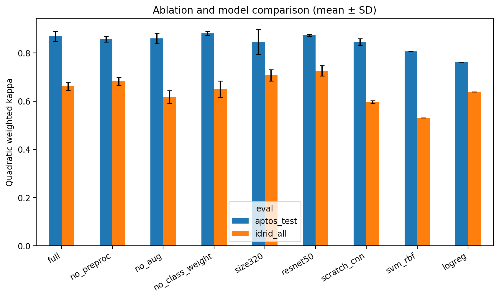

*Figure 6. QWK of every model on both test sets (mean ± SD).*

**Reading the table**
- On APTOS test, differences from `full` among the four one-component ablations are small and not
  statistically significant (section 8).
- `full` was chosen before the experiments. It is **not** shown to be the best: `no_preproc` and `resnet50`
  have higher validation QWK, by margins about the size of the seed-to-seed variation.
- This does not prove that preprocessing, augmentation or weighting have no effect. It means this
  experiment did not detect one on APTOS.

## 8. Experimental setup B: statistical analysis
| Method | Question it answers | Details |
|---|---|---|
| Repeated seeds | How much do results change between training runs? | mean ± sample SD, 3 seeds, fixed data split |
| Percentile bootstrap | How uncertain is a score because the test set is finite? | 2,000 resamples of test images, 95% CI; paired resampling for differences |
| Exact McNemar test | Do two models differ in 5-grade accuracy? | binomial test on images where exactly one model is correct |
| DeLong test | Do two models differ in referable-DR AUC? | for two correlated AUCs on the same images |
| Holm–Bonferroni | Correction for multiple comparisons | applied separately to McNemar and to DeLong, within each test set (8 comparisons) |

**McNemar:** with $b$ images only model A gets right and $c$ images only model B gets right, under the null
hypothesis $b \sim \text{Binomial}(b+c,\ 0.5)$.

**DeLong:** with structural components $V_{10}$ (one per positive image, $m$ of them) and $V_{01}$ (one per
negative image, $n$ of them), the covariance of the two AUCs is $S = S_{10}/m + S_{01}/n$, and

$$z = \frac{AUC_A - AUC_B}{\sqrt{S_{AA} + S_{BB} - 2S_{AB}}}$$

All tests use probabilities **averaged over the 3 seeds**. Their point values therefore differ from the
per-seed means in section 6 (for `full` on APTOS test: 0.883 averaged, 0.869 per-seed mean).
**Do not mix the two in one comparison.** The tests reflect sampling of test images, not training randomness.
No paired t-test was run.

### QWK with bootstrap 95% confidence intervals
| Model | APTOS test QWK [95% CI] | IDRiD QWK [95% CI] |
|---|---|---|
| full | 0.883 [0.849, 0.913] | 0.667 [0.608, 0.719] |
| no_preproc | 0.879 [0.850, 0.904] | 0.709 [0.659, 0.754] |
| no_aug | 0.876 [0.844, 0.905] | 0.647 [0.588, 0.698] |
| no_class_weight | 0.896 [0.866, 0.922] | 0.679 [0.618, 0.734] |
| size320 | 0.889 [0.860, 0.915] | 0.728 [0.681, 0.771] |
| resnet50 | 0.885 [0.855, 0.910] | 0.714 [0.664, 0.759] |
| scratch_cnn | 0.853 [0.814, 0.887] | 0.586 [0.529, 0.643] |
| svm_rbf | 0.807 [0.767, 0.844] | 0.531 [0.468, 0.588] |
| logreg | 0.763 [0.710, 0.809] | 0.639 [0.588, 0.688] |

### Paired tests: `full` against each other model
Differences are `full` minus the other model. Columns ending in `_holm` are corrected p-values;
the QWK intervals are not corrected. Corrected values below 0.05 are treated as significant.

**APTOS test**

| comparison | qwk_diff | qwk_diff_ci95 | accuracy_diff | mcnemar_p | auc_diff | delong_p | mcnemar_p_holm | delong_p_holm |
|---|---|---|---|---|---|---|---|---|
| full vs no_preproc | 0.004 | [-0.022, 0.032] | 0.0057 | 0.795 | 0.00289 | 0.289 | 1 | 1 |
| full vs no_aug | 0.0068 | [-0.024, 0.039] | -0.0038 | 0.911 | 0.00378 | 0.345 | 1 | 1 |
| full vs no_class_weight | -0.0129 | [-0.038, 0.013] | -0.0247 | 0.111 | 3.04e-05 | 0.984 | 0.667 | 1 |
| full vs size320 | -0.00594 | [-0.039, 0.026] | -0.0038 | 0.905 | 0.00708 | 0.0382 | 1 | 0.191 |
| full vs resnet50 | -0.00234 | [-0.025, 0.020] | 0.0114 | 0.497 | 0.000441 | 0.843 | 1 | 1 |
| full vs scratch_cnn | 0.0296 | [0.001, 0.060] | 0.0532 | 0.00152 | 0.00997 | 0.011 | 0.0106 | 0.066 |
| full vs svm_rbf | 0.076 | [0.033, 0.119] | 0.0228 | 0.285 | 0.0181 | 0.00183 | 1 | 0.0128 |
| full vs logreg | 0.12 | [0.071, 0.169] | 0.106 | 4.04e-07 | 0.0261 | 0.000123 | 3.23e-06 | 0.000982 |

**IDRiD, all 516**

| comparison | qwk_diff | qwk_diff_ci95 | accuracy_diff | mcnemar_p | auc_diff | delong_p | mcnemar_p_holm | delong_p_holm |
|---|---|---|---|---|---|---|---|---|
| full vs no_preproc | -0.0414 | [-0.089, 0.002] | -0.0329 | 0.128 | -0.00584 | 0.441 | 0.344 | 0.441 |
| full vs no_aug | 0.0199 | [-0.028, 0.067] | -0.0698 | 0.00156 | -0.012 | 0.13 | 0.00782 | 0.39 |
| full vs no_class_weight | -0.0113 | [-0.060, 0.038] | -0.0891 | 2.2e-06 | -0.0188 | 0.00116 | 1.76e-05 | 0.00694 |
| full vs size320 | -0.0609 | [-0.110, -0.016] | -0.0891 | 4.41e-05 | -0.0344 | 8.58e-05 | 0.000309 | 0.000687 |
| full vs resnet50 | -0.0464 | [-0.096, -0.000] | -0.031 | 0.163 | -0.0217 | 0.00342 | 0.344 | 0.0171 |
| full vs scratch_cnn | 0.081 | [0.023, 0.139] | 0.0504 | 0.0304 | -0.0138 | 0.152 | 0.122 | 0.39 |
| full vs svm_rbf | 0.136 | [0.071, 0.205] | -0.0407 | 0.115 | 0.0527 | 0.000385 | 0.344 | 0.0027 |
| full vs logreg | 0.0283 | [-0.034, 0.086] | 0.101 | 0.00013 | 0.0319 | 0.0211 | 0.000782 | 0.0845 |

**Findings**
- **APTOS test:** no ablation and not ResNet50 differs significantly in McNemar or DeLong. `full` beats the
  scratch CNN in accuracy (McNemar), logistic regression in accuracy and AUC, and the SVM in AUC.
- **IDRiD:** `size320` and `no_class_weight` are significantly better than `full` in accuracy and AUC;
  `resnet50` is significantly better in AUC. `no_aug` has significantly higher accuracy than `full`,
  although its per-seed mean QWK is lower.
- McNemar and QWK can disagree: McNemar counts only exact hits, while QWK also weighs how far off a wrong grade is.

## 9. Experimental setup C: cross-dataset validation
**Design:** train on one dataset, test on that dataset's own test set and on the other dataset, in both directions.
- **APTOS → IDRiD:** trained and selected on APTOS only. All 516 IDRiD images are unseen.
- **IDRiD → APTOS:** trained on 351 IDRiD images, selected on 62, tested on the 103 official IDRiD test
  images and the 526-image APTOS test split (30 epochs).

Drop = same-dataset score minus other-dataset score (negative means the other-dataset score was higher).

| direction | metric | same_dataset | other_dataset | drop |
|---|---|---|---|---|
| APTOS -> IDRiD | qwk | 0.869 | 0.663 | 0.207 |
| APTOS -> IDRiD | accuracy | 0.768 | 0.432 | 0.337 |
| APTOS -> IDRiD | macro_f1 | 0.601 | 0.398 | 0.203 |
| APTOS -> IDRiD | referable_auc | 0.981 | 0.908 | 0.073 |
| APTOS -> IDRiD | sensitivity | 0.847 | 0.765 | 0.082 |
| APTOS -> IDRiD | specificity | 0.966 | 0.898 | 0.068 |
| IDRiD -> APTOS | qwk | 0.609 | 0.491 | 0.118 |
| IDRiD -> APTOS | accuracy | 0.44 | 0.481 | -0.041 |
| IDRiD -> APTOS | macro_f1 | 0.371 | 0.305 | 0.066 |
| IDRiD -> APTOS | referable_auc | 0.852 | 0.815 | 0.037 |
| IDRiD -> APTOS | sensitivity | 0.771 | 0.748 | 0.023 |
| IDRiD -> APTOS | specificity | 0.778 | 0.729 | 0.049 |

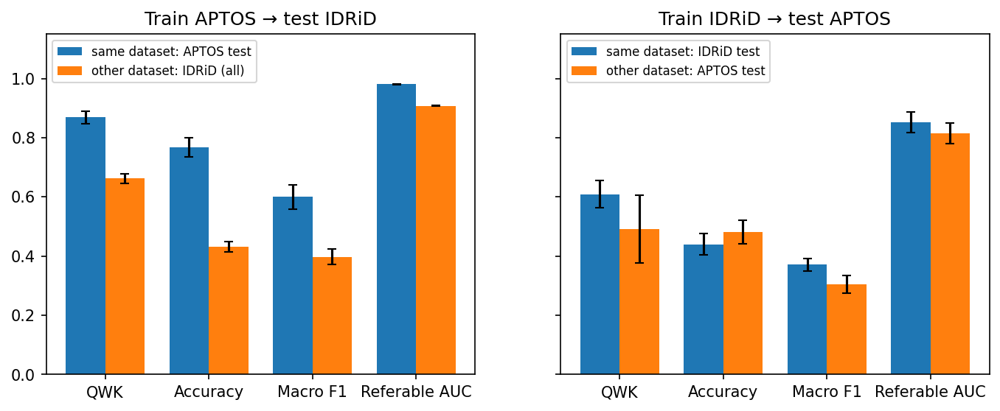

*Figure 7. Cross-dataset performance in both directions (mean ± SD, 3 seeds).*

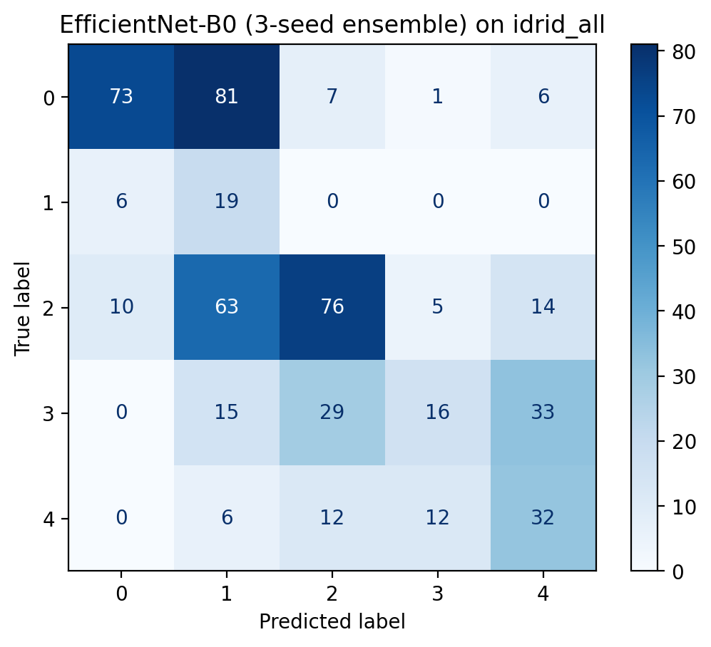

*Figure 8. APTOS-trained EfficientNet-B0 on all IDRiD images (seed-averaged). Many grade 0 and grade 2 images
are predicted as grade 1.*

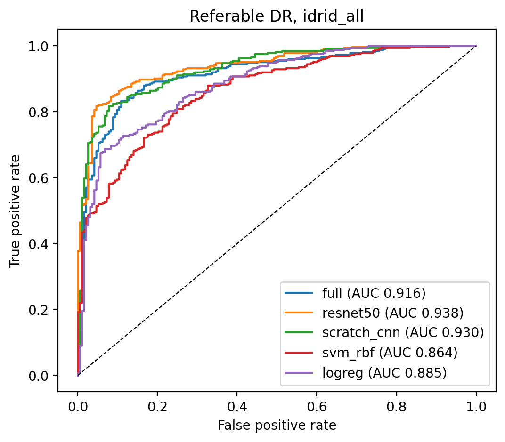

*Figure 9. Referable-DR ROC curves on IDRiD.*

**Findings**
- Every APTOS-trained model scores lower QWK on IDRiD than on APTOS test.
- For the main setup, referable-DR AUC falls much less than 5-grade QWK.
- The cause of the drop was not tested. Differences in cameras, patients or grading practice are possible explanations.
- The two directions are not directly comparable: their training sets differ greatly in size.
  The IDRiD → APTOS QWK also varies widely between seeds.

## 10. Separate experiment: fine-tuning on IDRiD
This is **domain adaptation**, not cross-dataset validation: the model now sees labelled IDRiD images.
It does **not** replace the 0.663 result in section 9.

**Design (settings fixed before running, run once):** take the APTOS-trained EfficientNet-B0; continue training
on 351 IDRiD images (learning rate 1e-4, 15 epochs); select the epoch on 62 IDRiD validation images; test on
the 103 official IDRiD test images. Each fine-tuned model is compared with the exact checkpoint it started from.
The experiment was added after the section 9 results had been seen.

| Test set | Model | QWK | Accuracy | Macro F1 | Macro AUC | Referable AUC | Sensitivity | Specificity |
|---|---|---|---|---|---|---|---|---|
| idrid_test | before | 0.526 ± 0.031 | 0.356 ± 0.022 | 0.334 ± 0.025 | 0.777 ± 0.029 | 0.840 ± 0.012 | 0.719 ± 0.016 | 0.803 ± 0.015 |
| aptos_test | before | 0.869 ± 0.021 | 0.768 ± 0.033 | 0.601 ± 0.041 | 0.934 ± 0.007 | 0.981 ± 0.002 | 0.847 ± 0.016 | 0.966 ± 0.008 |
| idrid_test | fine-tuned | 0.590 ± 0.038 | 0.469 ± 0.015 | 0.421 ± 0.037 | 0.775 ± 0.038 | 0.850 ± 0.002 | 0.792 ± 0.079 | 0.744 ± 0.128 |
| aptos_test | fine-tuned | 0.834 ± 0.036 | 0.736 ± 0.021 | 0.577 ± 0.021 | 0.896 ± 0.015 | 0.955 ± 0.028 | 0.899 ± 0.032 | 0.902 ± 0.061 |

Paired tests (seed-averaged, fine-tuned minus before, p-values not corrected):

| eval | images | qwk_base | qwk_finetuned | qwk_diff_ci95 | accuracy_diff | mcnemar_p | auc_diff | delong_p |
|---|---|---|---|---|---|---|---|---|
| idrid_test | 103 | 0.536 | 0.579 | [-0.080, 0.164] | 0.175 | 0.00143 | 0.008 | 0.594 |
| aptos_test | 526 | 0.883 | 0.852 | [-0.059, -0.005] | -0.046 | 0.0127 | -0.009 | 0.00257 |

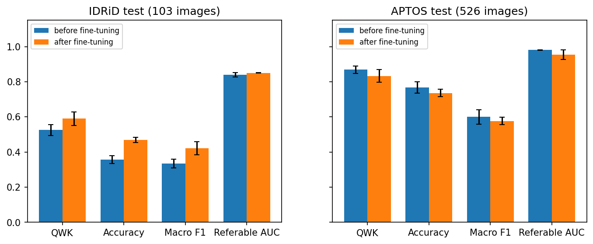

*Figure 10. Before and after fine-tuning on both test sets (mean ± SD).*

**Findings**
- On IDRiD test, mean QWK rose from 0.526 to 0.590, but the QWK difference is **not significant**
  (the bootstrap interval includes 0). Accuracy rose significantly. Referable AUC did not change significantly.
- On APTOS test, mean QWK, accuracy and referable AUC all fell, and the paired tests indicate a significant drop
  (partial *forgetting* of the original data).
- Training on IDRiD alone (section 9) scored QWK 0.609 ± 0.046 on the same 103 images, so fine-tuning
  showed no advantage over it in mean QWK (the two were not tested statistically).
- The "before" QWK here (0.526) is lower than 0.663 because it uses only the 103 test images.
  **Compare only values on the same images.**

## 11. Explainability: Grad-CAM
For class $c$, each of the last convolutional feature maps $A^k$ is weighted by the average gradient of the
class score $y^c$:

$$\alpha_k^c = \frac{1}{HW}\sum_{u,v}\frac{\partial y^c}{\partial A^k_{uv}},\qquad
L^c = \mathrm{ReLU}\Big(\sum_k \alpha_k^c A^k\Big)$$

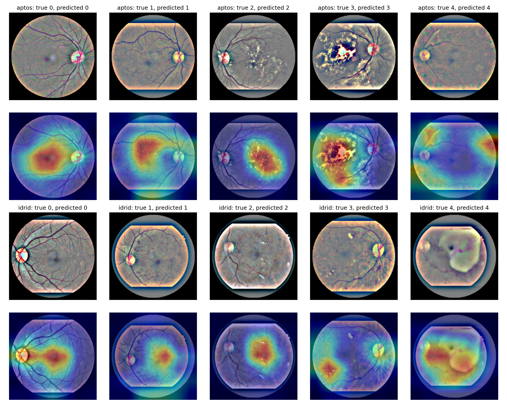

*Figure 11. EfficientNet-B0 (seed 0). Rows 1–2: APTOS test; rows 3–4: IDRiD. Warm colours mark regions that
raise the predicted grade's score.*

**Caution:** these are the most confident **correct** examples of each grade, not a random sample. Several maps
cover areas with visible lesions, but some highlight image borders or normal-looking retina.
They are not proof that the model detects lesions. No comparison with lesion annotations was made.

## 12. Limitations
- One fixed data split and 3 seeds; short training and little hyperparameter tuning.
- Only exact duplicates were removed. Near-duplicates may remain, and the APTOS label file has no patient IDs,
  so images of one patient could fall in different splits. APTOS test scores may be optimistic.
- Validation sets are small, especially IDRiD (62 images). IDRiD has only 25 grade 1 images.
- Only one external dataset.
- The 0.5 referable-DR threshold was not tuned or calibrated.
- IDRiD results have been inspected; further changes chosen by looking at them would no longer be an unbiased test.
- This is a course project, **not** a validated clinical tool.

## 13. Code explanation, file by file
| File | Purpose |
|---|---|
| `src/split.py` | deduplicate and split APTOS |
| `src/data.py` | dataset table, preprocessing, image cache |
| `src/baseline.py` | hand-crafted features, SVM and logistic regression |
| `src/train.py` | neural-network experiments |
| `src/progress.py` | progress bar |
| `src/analyze.py` | metrics, statistical tests, cross-dataset tables, figures |
| `src/gradcam.py` | Grad-CAM figure |
| `src/finetune.py` | fine-tuning on IDRiD |
| `src/figures.py` | dataset, preprocessing, cross-dataset and fine-tuning figures |

### 13.1 `split.py`
- **Hashing:** computes an MD5 hash of every APTOS image file; equal hashes mean identical files.
- **Cleaning:** keeps only hash groups with a single grade, then one image per hash.
- **Splitting:** two stratified `train_test_split` calls give 70% train, then halve the rest into validation and test.
- **Check and output:** asserts that no hash repeats and writes `results/splits.csv`.

### 13.2 `data.py`
- **`table()`:** builds one table of all 4,020 images (dataset, split, grade, path), including the IDRiD
  validation hold-out. Its row order matches the image cache and every saved prediction.
- **`crop_retina()`:** finds the pixels brighter than the threshold and cuts to their bounding box.
- **`square()`:** pads the shorter side with black, then resizes.
- **`ben_graham()`:** the formula in section 3 using `cv2.addWeighted` and `cv2.GaussianBlur`, then the circular mask.
- **`process()` and main block:** preprocesses images in 8 parallel processes and saves two arrays,
  `plain.npy` and `graham.npy`, so this work is done once. Also writes `results/images.csv`.

### 13.3 `baseline.py`
- **`lbp_hist()`:** local binary patterns. Each pixel is compared with its 8 neighbours, giving an 8-bit code;
  the 256-bin histogram of codes describes texture.
- **`features()`:** from the Ben Graham image: colour mean and SD (6 values), a 32-bin histogram per channel (96),
  a 16-bin edge-orientation histogram weighted by Sobel gradient magnitude (16) and the LBP histogram of the
  green channel (256), 374 features in total.
- **Models:** standardised features; logistic regression (C in 0.01, 0.1, 1, 10) and RBF SVM (C in 0.5, 2, 8),
  both with balanced class weights.
- **Selection:** the C with the best validation QWK; probabilities for all images are saved.

### 13.4 `train.py`
- **Configuration:** `BASE` holds the main setup. Each entry of `EXPERIMENTS` lists only what it changes.
- **`ScratchCNN`:** the five-block network of section 4.
- **`build()`:** creates the scratch CNN or an ImageNet-pretrained `timm` model with 5 outputs.
- **`batch_of()`:** takes a batch from the images held in GPU memory, resizes, augments (one affine matrix
  per image for rotation, mirror and scale; then brightness and contrast) and normalises.
- **`predict()`:** softmax probabilities without gradients or augmentation.
- **`run()`, setup:** fixes the random seeds, computes class weights from the training labels and creates the
  loss, AdamW and the one-cycle schedule. With `init`, it starts from a saved checkpoint (fine-tuning).
- **`run()`, training loop:** shuffle; forward pass in mixed precision; loss; scaled backward pass;
  optimiser and schedule steps. After each epoch it computes validation QWK and keeps the best weights.
- **`run()`, saving:** restores the best weights and saves probabilities for all images (`.npz`) and the
  configuration and history (`.json`). A finished run is skipped next time.
- **Main block:** runs every experiment for every seed.

### 13.5 `progress.py`
Counts finished prediction files every 5 seconds and draws a bar. It only reads files.

### 13.6 `analyze.py`
- **`qwk()`, `metrics()`:** the metrics of section 5.
- **`delong()`:** computes the structural components from ranks, then their covariance and the z-test.
- **`mcnemar()`, `holm()`, `boot_ci()`:** the test, correction and bootstrap of section 8.
- **`main()`, part 1:** per-seed metrics, then mean ± SD.
- **Part 2:** bootstrap intervals and paired tests on seed-averaged probabilities.
- **Part 3:** the cross-dataset table in both directions.
- **Parts 4–5:** confusion matrices, ROC curves, ablation chart, training curve and `results/SUMMARY.md`.
- **`self_check()`:** checks `qwk` and the DeLong AUCs against scikit-learn, and `holm` on a worked example,
  before any result is produced. It does not independently check the DeLong p-value.

### 13.7 `gradcam.py`
- **`gradcam()`:** gets the last feature maps, differentiates the class score with respect to them, averages
  the gradients into weights, sums the weighted maps, applies ReLU, upsamples and scales to 0–1.
- **Main block:** picks the most confident correct image per grade and dataset and overlays the heat map.

### 13.8 `finetune.py`
- **`FINETUNE`:** the fixed settings (IDRiD as source, learning rate 1e-4, 15 epochs).
- **`train_all()`:** for each seed, retrains the APTOS starting model, saves it, then continues it on IDRiD.
- **`report()`:** compares before and after on IDRiD test and APTOS test with the same metrics and tests.
  Outputs go to `results/finetune/`, leaving the main results unchanged.

### 13.9 `figures.py`
Draws figures 1, 2, 7 and 10 from the image table, the image cache and the metric CSV files.

## 14. How to run this project on a new PC
The commands below are for **Windows PowerShell**. They were developed on one Windows laptop (RTX 4060 Laptop GPU,
8 GB). They have not been tested on a second PC, in a new virtual environment, or on Linux or macOS.

### Choose what you want to do
| Goal | Needs | Steps |
|---|---|---|
| **A. Recreate the tables and most figures from the saved predictions** | Python only; no GPU, no datasets | 1, 2, 3 |
| **B. Retrain everything from scratch** | NVIDIA GPU, both datasets | 1, 2, 4, 5, 6 |

### Requirements
- Git and **Python 3.10** (64-bit).
- For B: an NVIDIA GPU with a recent driver. Training code requires CUDA; there is no CPU mode. All images are
  held in GPU memory, so use 8 GB or more (the only size tested).
- For B: about 20 GB of free disk space (APTOS about 9.6 GB, image cache 2.4 GB, plus libraries, IDRiD and models).
- An internet connection for installing libraries and, in B, downloading datasets and pretrained weights.

### Step 1: get the code
The repository is private, so the owner must first add you as a collaborator.

    git clone https://github.com/NikhilD2003/AI-based-Technology-for-Diabetic-Retinopathy.git
    cd AI-based-Technology-for-Diabetic-Retinopathy

### Step 2: create an environment and install the libraries
    py -3.10 -m venv .venv
    .venv\Scripts\python -m pip install --upgrade pip
    .venv\Scripts\python -m pip install -r requirements.txt --extra-index-url https://download.pytorch.org/whl/cu121

The PyTorch download is large. Calling `.venv\Scripts\python` directly means the environment does not need to be
activated. In PyCharm or VS Code, select this interpreter. For B, check that the GPU is visible (must print `True`):

    .venv\Scripts\python -c "import torch; print(torch.cuda.is_available())"

Versions: PyTorch 2.5.1 (CUDA 12.1), torchvision 0.20.1, timm 1.0.30, scikit-learn 1.7.2, SciPy 1.15.3,
NumPy 2.2.6, pandas 2.3.3, OpenCV 5.0.0, Matplotlib 3.10.9.

### Step 3 (goal A): recreate the results from saved predictions
    .venv\Scripts\python src/analyze.py

This rewrites the CSV files, `results/SUMMARY.md` and figures 3-6, 8 and 9. On a fresh clone of this project on
the development PC, with the GPU hidden and no datasets, the CSV files came out unchanged.
The other figures need the images, so use the committed copies. **Stop here for goal A.**

### Step 4 (goal B): download the datasets
1. **APTOS 2019:** sign in to Kaggle, accept the competition rules and download the data from
   https://www.kaggle.com/competitions/aptos2019-blindness-detection/data
2. **IDRiD:** download `B. Disease Grading.zip` from https://zenodo.org/records/17219542

Extract them so that the folders look exactly like this:

    data/
      APTOS/
        train.csv
        train_images/                      (3,662 .png files)
      IDRiD/
        B. Disease Grading/
          1. Original Images/
            a. Training Set/               (413 .jpg files)
            b. Testing Set/                (103 .jpg files)
          2. Groundtruths/                 (2 label .csv files)

### Step 5 (goal B): clear the saved predictions
**Important:** the repository includes saved predictions, and training **skips any run whose predictions exist**.
Without this step, nothing is retrained and the model files needed for Grad-CAM are not created
(model files are not on GitHub).

    Remove-Item -Recurse -Force results\preds, results\finetune\preds

This deletes only the clone's copies. They can be restored with `git checkout -- results`, which also discards
any other changes you made under `results/`. Do not run this step on the original working copy unless you intend
to retrain.

### Step 6 (goal B): run everything, in this order
    .venv\Scripts\python src/split.py       # results/splits.csv
    .venv\Scripts\python src/data.py        # image cache, results/images.csv
    .venv\Scripts\python src/baseline.py    # SVM and logistic regression
    .venv\Scripts\python src/train.py       # 24 neural-network runs
    .venv\Scripts\python src/analyze.py     # tables, tests, figures 3-6, 8, 9
    .venv\Scripts\python src/gradcam.py     # figure 11
    .venv\Scripts\python src/finetune.py    # separate fine-tuning experiment
    .venv\Scripts\python src/figures.py     # figures 1, 2, 7, 10

To watch training, run `.venv\Scripts\python src/progress.py` in a second terminal. On the development laptop,
most runs took 0.2-4 minutes each; allow about 45 minutes for the main training. Slower GPUs take longer.
If training stops, run the same command again: finished runs are skipped and the interrupted one starts over.
Retrained scores may differ somewhat from the committed ones, because GPU training is not guaranteed to be
bit-for-bit identical. The text of this README does not update itself.

### Common problems
| Problem | Fix |
|---|---|
| `Torch not compiled with CUDA enabled`, or the GPU check prints `False` | Check that you are using `.venv\Scripts\python`, the install used the `--extra-index-url` above, and the NVIDIA driver is up to date |
| `FileNotFoundError` under `data/cache` | Run `src/data.py` first (step 6) |
| `FileNotFoundError` for an image or label file | Compare your folders with step 4 |
| Training prints `ALL DONE` immediately | Saved predictions still exist: see step 5 |
| `gradcam.py` cannot find `full.pt` | Train after step 5 so the model file is created |
| `CUDA out of memory` | Close other GPU programs. On a smaller GPU the code would need changes (images are kept in GPU memory) |

### Where each paper item comes from

| Paper item | File it comes from | Script |
|---|---|---|
| Main and ablation tables | `results/metrics_summary.csv` | `analyze.py` |
| Confidence intervals | `results/bootstrap_ci.csv` | `analyze.py` |
| Significance tests | `results/significance_tests.csv` | `analyze.py` |
| Cross-dataset table | `results/cross_dataset.csv` | `analyze.py` |
| Fine-tuning tables | `results/finetune/*.csv` | `finetune.py` |

## 15. Notes for the paper author
- The result tables in sections 2 and 6–10 were filled by a script from the result files.
  Numbers quoted in the text were written by hand from the same results.
- Use QWK as the primary metric. State whether a number is a per-seed mean or from seed-averaged probabilities.
- Say "no significant difference detected", not "no effect". Do not call EfficientNet-B0 the best model.
- Report 0.663 as the cross-dataset result. Keep fine-tuning separate and labelled as domain adaptation.
- Add and **check** references for APTOS, EfficientNet, ResNet, AdamW, Grad-CAM, DeLong, McNemar, Holm,
  the bootstrap and Ben Graham's preprocessing. Only the IDRiD reference is given here.
- GitHub repository (private): https://github.com/NikhilD2003/AI-based-Technology-for-Diabetic-Retinopathy
